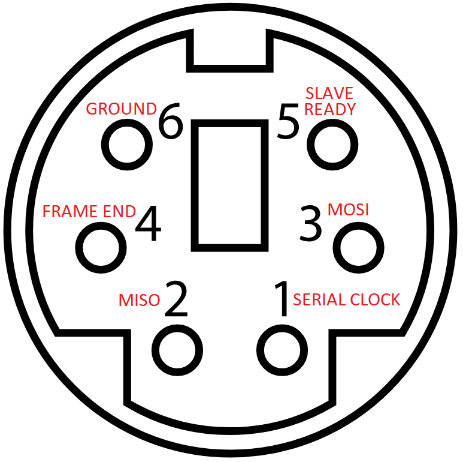

# smart_port_arduino
An Arduino sketch that listens to commands from its serial interface to perform commands via the Rokenbok Smart Port protocol.

## Smart Port Pinout

| Smart Port | Arduino | Function |
|---|---|---|
| 1 | 13 | Serial Clock |
| 2 | 12 | MISO |
| 3 | 11 | MOSI |
| 4 | - | Frame End* |
| 5 | 8 | Slave Ready |
| 6 | GND | Ground |
| - | 9** | Chip Select (Virtual) |
| - | 10** | Chip Select |

*The Frame End pin is 9-12V, be careful to avoid connecting the Arduino to it!

**Arduino pins 9 and 10 connect to each other for chip select simulation.

## Serial Settings

-   **Baud Rate:** 1,000,000 bps
-   **Data Bits:** 8
-   **Stop Bits:** 1
-   **Parity:** None

## PC-to-Arduino Communication

PC to Arduino communication consists of framed byte packets sent over the hardware serial interface.  The packet start byte determines the type of packet and all packets terminate with a standard end byte.

-   **Start Byte `253` (`0xFD`):** Initiates a Configuration Data packet.
-   **Start Byte `254` (`0xFE`):** Initiates a Player / User Data packet.
-   **End Byte `255` (`0xFF`):** Terminates the active packet and triggers processing on the Arduino.

### 1. Configuration Packet (`0xFD`)

Used to update global operational parameters on the Arduino.

| Byte Index | Field Name | Values / Description |
|---|---|---|
| 0 | Start Byte | `253` (`0xFD`) |
| 1 | share_mode | `0` = No Sharing, `1` = Allow Sharing* |
| 2 | is16sel_mode | `0` = 8 Selections, `1` = 16 Selections** |
| 3 | End Byte | `255` (`0xFF`) |

*Only affects if a plugged-in physical controller can share with virtual controllers.  Share logic for Smart Port users must be handled by the control program on the PC (if desired).

**Affects whether plugged-in physical controllers can select vehicles 9-15.

### 2. Player Data Packet (`0xFE`)

Used to send vehicle selection and button press data for each unique User ID to the Arduino.  The Arduino will assign each user to an available virtual (4), physical (4), or direct packet injection (4) controller.  The system prioritizes assigning Smart Port players to virtual, then physical, then DPI controllers.  **This packet must include all active users.**  If a user was included in a previous packet but is not included in the latest packet, the Arduino will assume that user should no longer be assigned a controller.

**Payload Structure:** Start byte, then a repeating sequence of **4-byte blocks** for each user entry, and finally the end byte.

| Byte Index | Field Name | Values / Description |
|---|---|---|
| 0 | Start Byte | `254` (`0xFE`) |
| 1 | User ID | Unique User ID from `2-252` |
| 2 | Vehicle Selection | `0–7` or `0–14` (8 vs 16 Selection), `15` (`0x0F`) = No Select / Unassigned |
| 3 | Directional Buttons | Bitmask (MSB to LSB): `[BLANK][BLANK][BLANK][BLANK][UP][DOWN][RIGHT][LEFT]` |
| 4 | Action Buttons | Bitmask (MSB to LSB): `[BLANK][BLANK][BLANK][A][B][X][Y][RT]` |
| ... | ... | ... |
| n | End Byte | `255` (`0xFF`) |

## Arduino-to-PC Status Response

After processing an incoming packet, the Arduino responds by streaming its current runtime state back to the host PC. The host program should listen for this telemetry block:

| Byte Index | Field Name | Values / Description |
|---|---|---|
| 0 | Start Byte | `254` (`0xFE`) |
| 1 | Status Byte | `0` = SP Not Connected, `1` = SP Connected |
| 2-13 | User IDs Array* | 12 bytes representing mapped user IDs. `0` = Unused, `1` = Plugged-in Physical Controller, `2-252` = Smart Port User |
| 14-25 | Selects Array* | 12 bytes representing active vehicle selections |
| 26 | End Byte | `255` (`0xFF`) |

*User ID and Selects Arrays are in the format [V1, V2, V3, V4, P1, P2, P3, P4, D1, D2, D3, D4], where V = Virtual, P = Physical, and D = Direct Packet Injection (DPI) controllers.

## Implementation Example

A simple python program is included for testing the Smart Port connection and as an implementation example.

## Other Projects

### https://github.com/csev1755/rokenbok-webserver

A Python Flask executable that serves a Rokenbok multiplayer web interface with optional live video. Integrates with this Arduino implementation for Smart Port control.

### https://github.com/stepstools/Rokenbok-Smart-Port-WiFi

Custom ESP32 Smart Port interface with web control.
